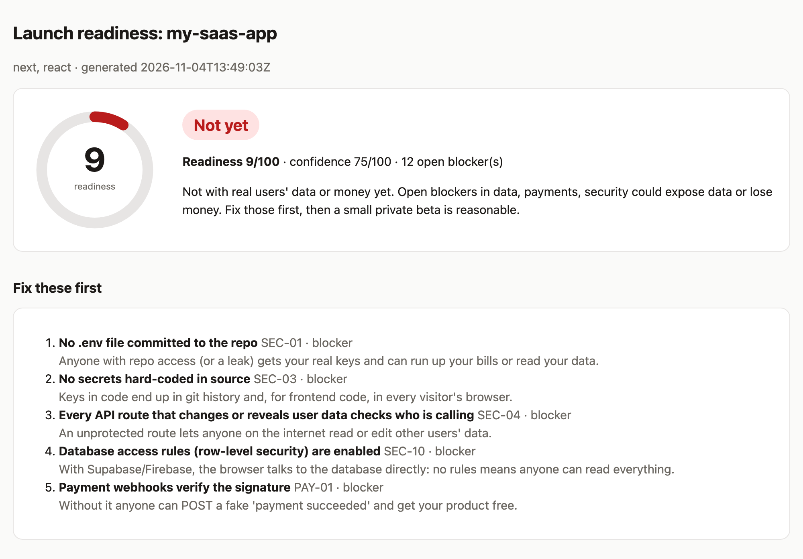
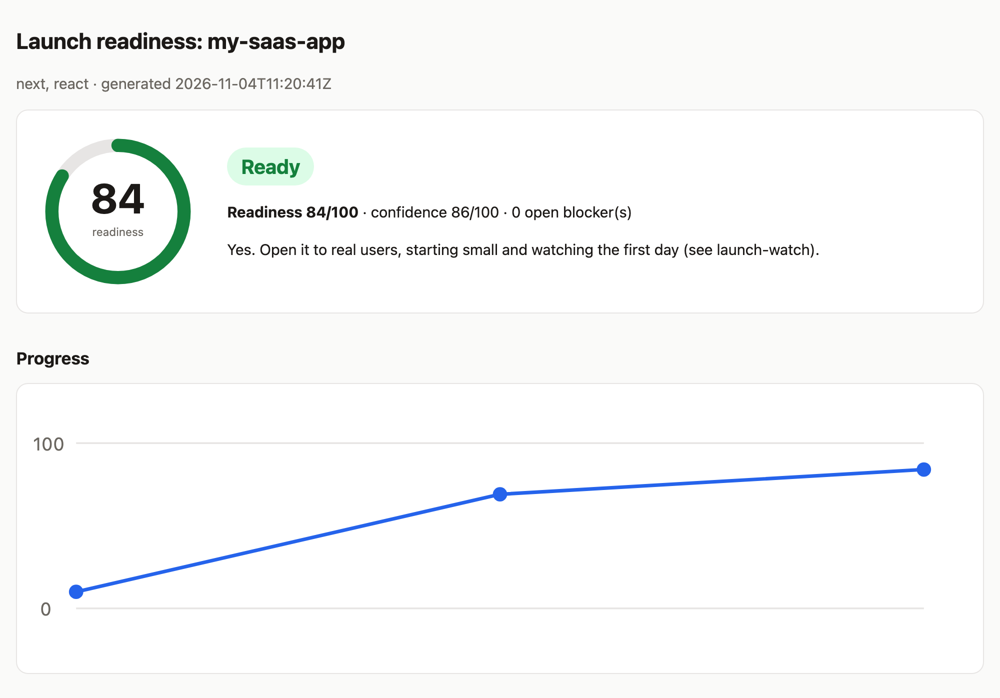
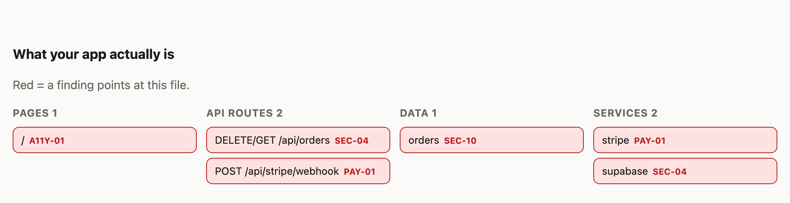
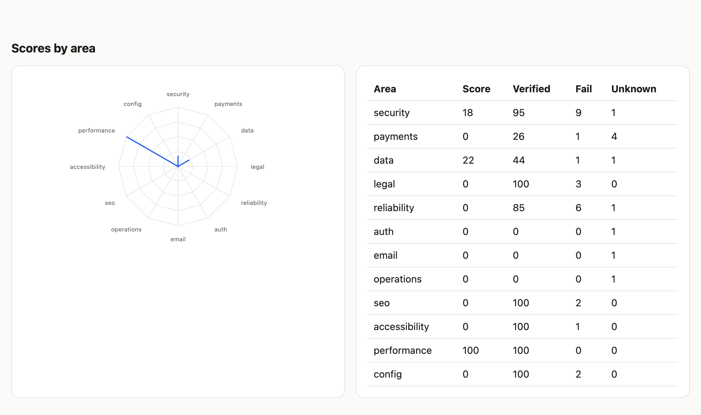
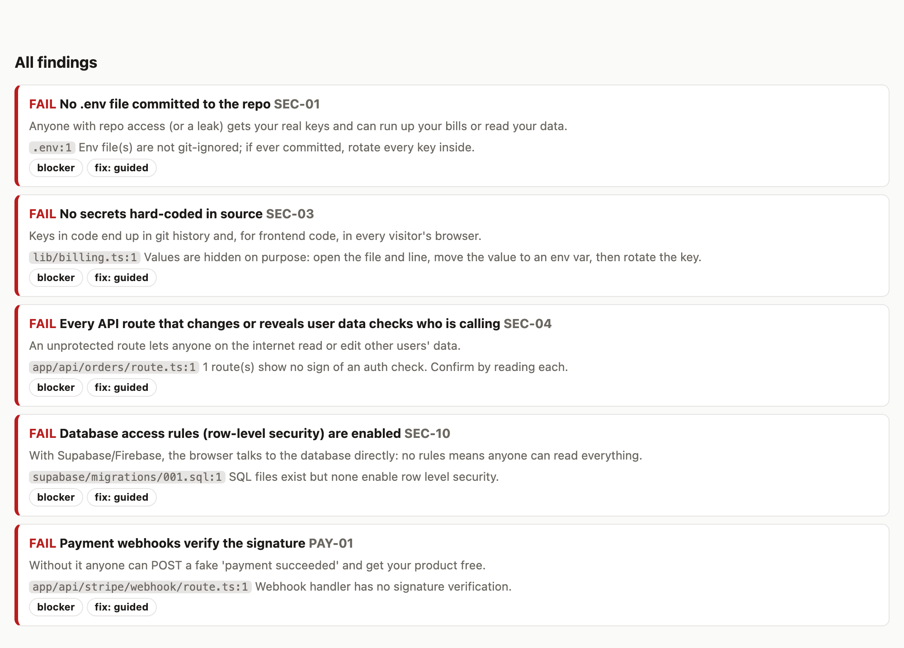
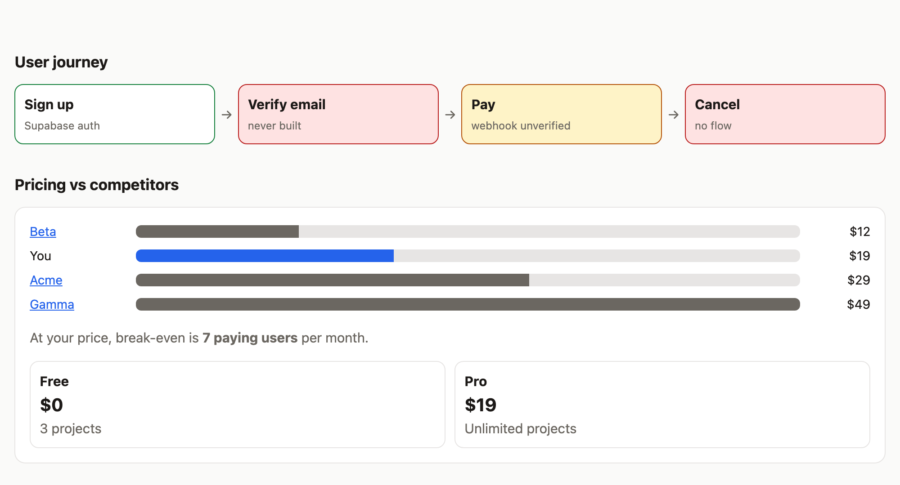
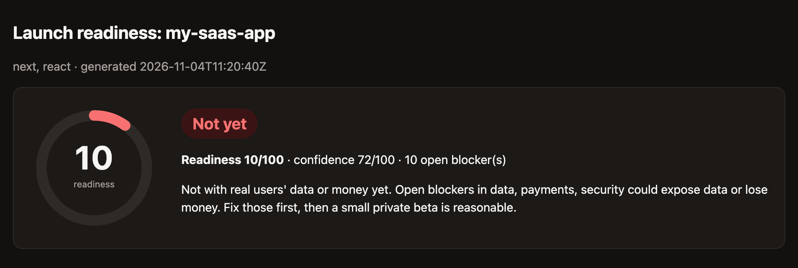
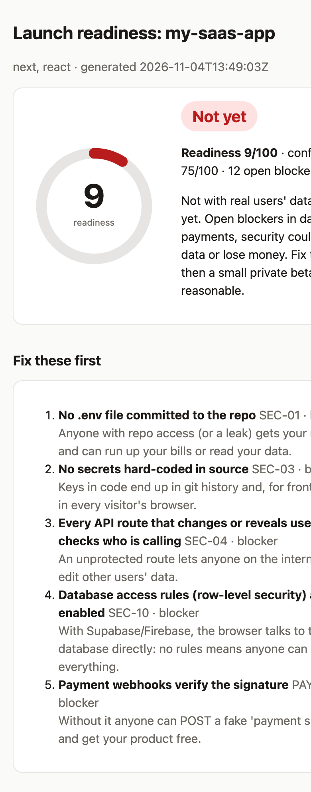
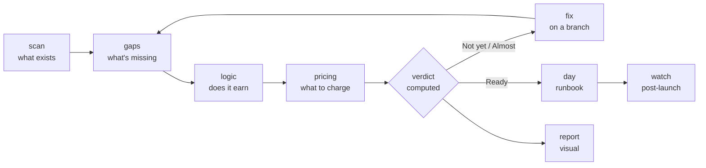

<h1 align="center">production-ready-skill</h1>

<p align="center"><a href="https://github.com/Gihonix/production-ready-skill/actions/workflows/tests.yml"></a> </p>

<p align="center"><b>Your AI wrote the code. Who checks it before real users do?</b></p>

<p align="center">
Ten <a href="https://claude.com/claude-code">Claude Code</a> skills that read your vibe-coded app, tell you what's actually in it, find what's missing <i>with proof</i>, and hand you a Ready / Almost / Not-yet verdict you can trust, then fix it, price it and plan the first 30 days live.
</p>

<p align="center">

</p>

---

## The problem

Vibe coding gets you to **"it works on my machine"** in a weekend. Then you stall.

- You don't fully know what the AI built, so you can't say what's safe.
- You can't see what's *missing*: no webhook check, no rate limit, no privacy page, no backup.
- Nobody gave you a checklist, and "looks fine" isn't a feeling you can launch on.
- Pricing is a guess. And after launch you have no idea what to watch.

So the app sits there, finished and unlaunched.

## The fix: one command

```
/launch
```

It answers the five questions that stand between you and going live:

| You're asking | this pack answers with |
| --- | --- |
| **What did the AI actually build?** | A plain-English tour: pages, API routes, data, services, and where your money and users' data touch the code |
| **What am I missing?** | A 40-item checklist run on *your* code. Every failure cites `file:line` |
| **Does the business actually work?** | The signup → pay → cancel path, paywall leaks, bot-cost abuse, flows nobody built |
| **What should I charge?** | Real competitor prices (linked), your cost per user, break-even, tiers |
| **Am I ready, and what then?** | A *computed* verdict, safe fixes on a git branch, a go-live runbook and a post-launch watch plan |

## See it

A real run on the demo app in [`examples/`](examples/sample-output) (a small Next.js + Supabase + Stripe app with planted flaws). The same pipeline took it from **Not yet (10/100)** to **Ready (84/100)**. Open the full interactive reports: [before](examples/sample-output/before/report.html) · [after](examples/sample-output/after/report.html) (download and open in a browser; they work offline).

**Your score climbs as you fix things.** Every run is remembered, so you can watch the number go up:



**A map of what your app actually is.** Files with problems turn red, tagged with the finding:



**Scores by area** so you know where the weight is:



**Findings you can filter, each one in plain language** with the exact file to open:



**Your user journey and pricing in one place.** Missing steps highlighted, your price against competitors, break-even:



<table>
<tr>
<td align="center"><b>Dark mode</b><br></td>
<td align="center"><b>Phone-sized</b><br></td>
</tr>
</table>

Everything above is one self-contained HTML file: no server, no CDN, no account, works offline, prints to PDF, safe to send to a cofounder.

---

## All ten skills

Run `/launch` for the whole journey, or any skill on its own. Everything is written to a `launch/` folder in your project. Only `launch-fix` ever edits your code, and only with your approval.

| Skill | Ask it | What it does in detail | Writes | Edits code? |
| --- | --- | --- | --- | --- |
| **`/launch`** | "Am I ready to launch?" | The orchestrator. Asks 3 or 4 questions the code can't answer (who is it for, does it take money, hold personal data, call paid APIs, where is it hosted), then runs the other skills in order and pauses after the verdict so you choose the next step. `--quick` runs scan, gaps, verdict and report only (a few minutes). States its limits up front. | `launch/` (all) | No |
| **`/launch-scan`** | "What did the AI build?" | Detects the stack (Next.js, React, Vue, Express, FastAPI, Flask, Django and more), pages, API routes with a first auth heuristic, database tables (SQL, Prisma, Drizzle, SQLAlchemy, Mongoose), 35+ third-party services (Stripe, Supabase, Firebase, OpenAI, Clerk, Resend, Sentry...), env var **names** (never values), tests, CI, lockfiles, deploy config, legal pages. Then writes a plain-language tour: what the app is, what a visitor can do, where data lives, where money and risk touch the code. | `map.md`, `inventory.json`, `context.json` | No |
| **`/launch-gaps`** | "What am I missing?" | Runs the 40-item checklist across **security** (committed `.env`, hard-coded keys, unprotected routes, rate limits, headers, CORS, debug mode, validation, row-level security, exposed public env vars), **payments** (webhook signature, idempotency, server-side paywall, failed-payment path, live keys), **data** (backups, migrations, account deletion), **reliability** (error tracking, health check, tests, CI, lockfile, error pages, timeouts), **legal** (privacy, terms, cookie consent, refunds), **SEO**, **accessibility**, **performance**, **config**, auth flows, email DNS, rollback. Each item is PASS / FAIL / UNKNOWN with evidence; heuristics are confirmed by reading the code. Loads stack guides for Next.js, Express, Python, Supabase, Stripe, Firebase. | `gaps.md`, `findings.json` | No |
| **`/launch-logic`** | "Does the business actually work?" | Traces sign up → verify → first value → paywall → pay → cancel → forgot password and marks each step ok / weak / missing. Attacks the model: can a free user call a paid API directly, can user A read user B's records, can one bot burn your AI bill in an hour, can trials be farmed, what breaks on double-clicks, retried webhooks, failed cards, deleted users. Finds the flows the AI never built. | `logic.md`, `logic.json` | No |
| **`/launch-pricing`** | "What should I charge?" | Finds 3 to 6 competitors and the substitute buyers use instead, reads their **own public pricing pages** (every figure linked and dated), models your cost to serve (hosting, AI/API calls, email, storage, payment fees) with a script, and recommends a price, tiers, the free-vs-paid line, an opening offer and **two prices to test** with real buyers. Never prices below cost without saying how long you can afford it. | `pricing.md`, `pricing.json` | No |
| **`/launch-verdict`** | "Can I go live?" | A script, not an opinion, computes **Ready / Almost / Not yet**: blockers weigh 5, should-fix 2, nice-to-have 1; only PASS earns points; unverified blockers block "Ready". Outputs readiness (how much passes) and **confidence** (how much was actually verified), per-area scores, the top five fixes, a rough fix-time estimate, and a straight answer to "is it safe to soft-launch?". | `verdict.md`, `verdict.json`, `history.json` | No |
| **`/launch-fix`** | "Fix what you found." | Works on its own branch (`launch-ready/fixes`), one commit per fix, so any fix is a `git revert` away. **Auto** fixes (gitignore, `.env.example`, headers, CORS, health endpoint, meta tags, 404 page, CI, error tracking, legal page templates) go in one approved batch. **Guided** fixes (auth and ownership checks, webhook signature, plan enforcement, validation, row-level security) show the diff and ask. **Manual** items (rotate a key, DNS, backups, live mode) get step-by-step instructions, never auto-done. Runs your tests after each fix and only marks a finding fixed when its check passes. 37 recipes included. | commits, `fixes.md` | **Yes**, with approval |
| **`/launch-report`** | "Show me." | Renders one offline HTML dashboard: verdict banner and gauge, top fixes, radar of scores, app map with red problem spots, user journey, competitor price chart, filterable findings board, score history across runs, and tickable launch and watch checklists. Light and dark, phone-friendly, printable. | `report.html` | No |
| **`/launch-day`** | "How do I go live safely?" | The runbook: a go/no-go gate, pre-flight (domain and HTTPS, production env var names, separate production database, email SPF/DKIM/DMARC, payments in live mode, API spend caps, legal links, monitoring), a **10-minute smoke test** to run after every deploy, a rollback plan, and announcement order (private beta → waitlist → public). Tailored to your host. Never runs deploy or DNS commands itself. | `runbook.md`, `checklist.json` | No |
| **`/launch-watch`** | "What do I do after launch?" | The post-prod plan: what to monitor (uptime, errors, slow pages, signup and payment funnel, failed payments, webhook failures, cost per user, abuse, database and backups, domain and certificate expiry) with thresholds; tools by stack and their free tiers; a launch-hour, week-one, day-30 and monthly routine; an incident playbook; alert rules. Ships starter templates: health endpoint, error-tracking init, uptime-check list. | `watch.md`, `monitoring/*` | No |

### What's behind the table

| Piece | Where | Detail |
| --- | --- | --- |
| Checklist catalog | [`checks.py`](skills/launch-gaps/checks.py) / [`checklist.md`](skills/launch-gaps/checklist.md) | 40 items, 30 of them mechanically checkable; severity rises with context (money, personal data) |
| Stack guides | [`stacks/`](skills/launch-gaps/stacks) | Next.js, Node/Express, Python, Supabase, Stripe, Firebase |
| Fix recipes | [`fixes/`](skills/launch-fix/fixes) | 37, one per fixable finding |
| Verdict rules | [`verdict.py`](skills/launch-verdict/verdict.py) | Deterministic and documented, never hand-written |
| Cost model | [`cost_model.py`](skills/launch-pricing/cost_model.py) | Per-user contribution, margin, break-even, profit at N users |
| Watch templates | [`templates/`](skills/launch-watch/templates) | Health endpoint, error tracking, uptime checks, alert rules, incident playbook |

## How it flows



## Install

Requires Claude Code and Python 3.8+ (nothing else to install).

```bash
git clone https://github.com/Gihonix/production-ready-skill.git
cd production-ready-skill
./install.sh              # all your projects (~/.claude/skills)
# ./install.sh --project  # just the current project
```

Windows: `.\install.ps1`. Plugin: the repo includes `.claude-plugin/plugin.json`.

Then open your project in Claude Code:

```
/launch            # the full journey
/launch --quick    # verdict and picture in a few minutes
```

## Why you can trust the answer

- **Evidence or it didn't happen.** A failure cites `file:line`. If code can't tell (are backups on? is DNS set?) it's `UNKNOWN`, never a pass.
- **Computed, not opined.** The verdict comes from a script with published rules. You can't be talked into "Ready".
- **Confidence is separate from readiness.** A high score built on guesses shows up as low confidence.
- **Safe fixes.** Own branch, one commit per fix, your tests after each, no deploys, no force-push. Outside-the-code steps are instructions, not actions.
- **Secrets never printed.** Env vars by name only; secret finds report file, line and type, not the value. A test enforces it.
- **Competitor facts are cited.** Public pages, links, dates.

## Honest limits

It reads code and config. It can't see your dashboards, DNS, live data or real traffic, so some items stay "unverified" until you confirm them (and unverified is never counted as passed). Heuristics can miss things or over-flag, so each finding tells you where to look. It is **not** a penetration test, a security certification, or legal or financial advice. If you handle payments or sensitive data at scale, get a professional review. Legal pages it drafts are templates.

## FAQ

**Does it send my code anywhere?** The scripts make no network calls. Claude reads your files as it does in any Claude Code session. Only `launch-pricing` looks things up on the web (competitor pricing pages).

**Will it change my code?** Only `/launch-fix`, on a separate branch, after you approve. Everything else writes into a `launch/` folder (add it to `.gitignore`: the report describes your weaknesses).

**Does it work for my stack?** Any web project gets the core checks. Next.js, Express, Python (FastAPI/Flask/Django), Supabase, Firebase and Stripe get deeper ones. Add yours: see [CONTRIBUTING](CONTRIBUTING.md).

**Why would it say "Almost" when everything passes?** Because backups, live-mode keys and plan enforcement can't be seen from code. Confirm them and it flips to Ready.

## Develop

```bash
python3 tests/run_tests.py                 # 45 checks on fixture apps with planted flaws
python3 scripts/make_sample.py             # regenerate examples/sample-output
python3 scripts/make_screenshots.py        # regenerate docs/img (needs Chrome and Pillow)
```

Built and maintained by Gihonix Solutions. MIT licensed. Contributions welcome: [CONTRIBUTING.md](CONTRIBUTING.md).
